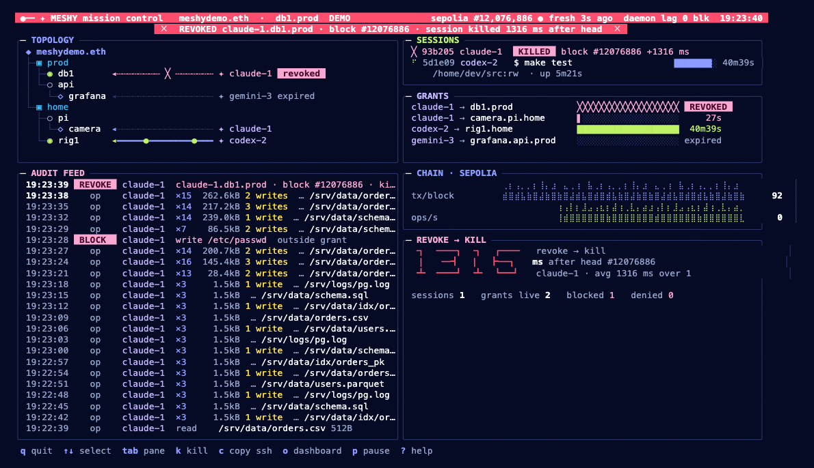

# Meshy CLI: a mission-control terminal UI

**Status (6 Nov 2026):** the prototype works. `meshyd top` and `meshy top` ship inside the existing static binaries and show live data from api.meshy.live, Sepolia and Arkiv. `--demo` plays a canned revoke for screenshots. The dashboard lives in [`meshy/tui/`](../../meshy/tui/).



*`meshyd top --demo --at 21s`: the admin revoked claude-1's grant on db1. The session was killed 1,316 ms after the block landed. The PNG comes from the ANSI capture rendered in a browser, which is why braille and the big digits look a little uneven. A real terminal lines them up.*

---

## 1. Try it

```bash
cd meshy && go build -o /tmp/ ./cmd/meshy ./cmd/meshyd
```

```bash
/tmp/meshyd top --demo
```

```bash
/tmp/meshy top --org meshydemo.eth
```

| Command | What you get |
|---|---|
| `meshyd top` | The device view: the daemon's sessions (with kill), the live audit stream from the control socket, and "daemon lag" against the public Sepolia head. The org is taken from the daemon's own ENS name |
| `meshyd status -w` | Now opens the same dashboard on a TTY. Add `-plain` for the old refreshing text view |
| `meshy top` | The agent or org view: the topology and grants from `/v1/map`, the Sepolia ticker, and the org-wide Arkiv feed (attributes only; payloads stay sealed). It uses the org of `~/.meshy/agent.json`, else `--org`, else `meshydemo.eth` |
| `… top --demo [--at 21s]` | A deterministic 40 s loop with no network: work → blocked write (9 s) → revoke and kill (20 s) → re-grant (31 s) |
| `… top --json` | The same state as JSON. This is also the default whenever stdout is not a TTY, so agents and Claude calling `meshy top` get data, not escape codes |
| `… top --once [--width W --height H] [--color]` | One rendered frame to stdout, used for the captures in [`captures/`](captures/) |
| `meshyd init` | Prints the logo to stderr first, and only when stderr is a terminal. Stdout (the join code) is unchanged |

Shared flags: `--org --api --rpc --arkiv ("-" turns it off) --dashboard --ascii --no-splash`. Environment: `MESHY_ORG`, `MESHY_API`/`MESHY_PROVIDER`, `MESHY_SEPOLIA` (a `ws://` URL falls back to the public HTTPS RPC), `MESHY_ARKIV_RPC`, `MESHY_ASCII`, `MESHY_NO_SPLASH`, `NO_COLOR`.

---

## 2. Findings: which approach

The constraints: it must ship inside our single static binaries (`CGO_ENABLED=0`) with nothing extra to install, work over SSH and in macOS Terminal and iTerm2, degrade cleanly (no colour, small terminals, non-TTY, agents), and stay cheap on CPU.

| Option | Ships in our binary | Over SSH, stock terminals | Degrades | Animation | Verdict |
|---|---|---|---|---|---|
| **Bubble Tea + Lip Gloss** (pure Go) | Yes. +1.35 MB on `meshyd` (17.7 → 19.0 MB, linux/amd64, still static) | Yes: plain ANSI, alt screen, resize events | Lip Gloss/termenv honour `NO_COLOR` and fall back from truecolor to 256 to 16 colours to none by themselves | An Elm-style update loop with a tick message. Each frame is a pure function of state, which is what makes `--once`/`--demo --at` captures reproducible | **Chosen** |
| tview / termdash / gocui | Yes | Yes | Weaker theming. termdash brings its own widgets but is less flexible to style | Possible but more imperative | Good for forms. Not worth a second framework |
| ntcharts / asciigraph | Yes | Yes | n/a | Charts only | Not needed: a braille sparkline is about 50 lines (`render.go: spark`) |
| **tmux layout** (`meshy top --tmux` splitting panes running `meshyd logs -f`, `status -w`, …) | Needs tmux on the host: not on stock macOS, rarely on servers | Only if tmux is installed | Breaks when it is absent | None of its own; panes are plain text | **Rejected as the core.** Optional later: Bubble Tea runs fine *inside* tmux, and OSC 52 copy works there with `set -g set-clipboard on` |
| Raw ANSI + braille, hand-rolled | Yes | Yes | Every fallback written by hand | Full control | **Used for the parts that matter** (braille sparkline, eighth-block bars, packet edges, big digits) and drawn inside Bubble Tea's frame |
| Kitty/iTerm/Sixel images | Yes | Only some terminals; not macOS Terminal | Poorly | Real pixels | Rejected: breaks the "no plugin, any terminal" rule |

So we use one framework for the event loop, resize and alt screen, and hand-rolled glyph rendering on top. Everything is standard Unicode box drawing, block elements and braille (U+2800), which every font in macOS Terminal and iTerm2 has. `--ascii` covers the rest.

---

## 3. Screens

### 3.1 `top`: mission control (wide, ≥ 110 columns)

```
 ◉━ ✦ MESHY mission control   meshydemo.eth · db1.prod  DEMO      sepolia #12,076,886 ● fresh 3s ago  daemon lag 0 blk  19:23:40
                ╳  REVOKED claude-1.db1.prod · block #12076886 · session killed 1316 ms after head  ╳        ← flashes red for 3 s
╭─ TOPOLOGY ──────────────────────────────────╮╭─ SESSIONS ───────────────────────────────────────╮
│ ◆ meshydemo.eth                             ││ ╳ 93b205 claude-1  KILLED block #12076886 +1316 ms│  ← the dying session lingers 8 s
│ ├─▣ prod                                    ││ ⠋ 5d1e09 codex-2  $ make test       ███████░ 40m39s│
│ │ ├─◉ db1     ◂┄┄┄┄ ╳ ┄┄┄┄ ✦ claude-1 revoked││     /home/dev/src:rw · up 5m21s                    │
│ │ └─○ api                                   │╰───────────────────────────────────────────────────╯
│ │   └─◇ grafana ◂┄┄┄┄┄┄┄┄┄ ✦ gemini-3 expired│╭─ GRANTS ─────────────────────────────────────────╮
│ └─▣ home                                    ││ claude-1 → db1.prod        ╳╳╳╳╳╳╳╳╳╳  REVOKED  │
│   ├─○ pi                                    ││ claude-1 → camera.pi.home  ▌░░░░░░░░░     27s   │  ← draining bars, lime → sun → pink
│   │ └─◇ camera ◂┄┄┄┄┄┄┄┄┄┄ ✦ claude-1       ││ codex-2 → rig1.home        ██████████  40m39s   │
│   └─◉ rig1    ◂━━━●━━━━━●━━ ✦ codex-2       ││                                                 │  ← packets flow agent → device
╰─────────────────────────────────────────────╯╰─────────────────────────────────────────────────╯
╭─ AUDIT FEED ────────────────────────────────╮╭─ CHAIN · SEPOLIA ───────────────────────────────╮
│ 19:23:39 REVOKE claude-1 db1.prod · #12076886││ tx/block ⣀⣠⣤⣴⣶⣾⣿⣷⣶⣤⣀⣠⣤⣴⣶  92                   │  ← braille, 2 rows, 8 levels
│ 19:23:38   op   claude-1 ×15 262kB 2 writes … ││ ops/s    ⣿⣿⣿⣿⣷⣿⣿⣿⣿⣿⣿⣀      0                   │
│ 19:23:28 BLOCK  claude-1 write /etc/passwd    │╰─────────────────────────────────────────────────╯
│ …                                           ││╭─ REVOKE → KILL ────────────────────────────────╮
│                                             ││ ┓ ━━┓ ┓ ┏━━  revoke → kill                     │  ← big digits; red during a flash
│                                             ││ ┃  ━┫ ┃ ┣━┓  ms after head #12076886            │
│                                             ││ ┻ ━━┛ ┻ ┗━┛  claude-1 · avg 1316 ms over 1      │
╰─────────────────────────────────────────────╯╰─────────────────────────────────────────────────╯
 q quit  ↑↓ select  tab pane  k kill  c copy ssh  o dashboard  p pause  ? help
```

Exact captures: [`captures/01-working.txt`](captures/01-working.txt), [`02-blocked`](captures/02-blocked.txt), [`03-revoke`](captures/03-revoke.txt), [`04-regrant`](captures/04-regrant.txt). The ANSI versions (`*.ans`) can be replayed with `cat captures/03-revoke.ans`. There are also PNGs: [01-working.png](01-working.png), [03-revoke.png](03-revoke.png) and [00-splash.png](00-splash.png).

What moves, and why:
- **Packets on topology edges.** Two `●` travel from the agent toward the device while a session is live (or ops happened in the last 15 s). Idle grants are a dotted `┄`. A revoked grant is cut with `╳`. Device glyphs pulse (`◉◎◉●`) while in use.
- **Grant bars drain** in eighth-block steps over a 15 min horizon. Colour shifts lime → sun (< 5 min) → pink (< 2 min).
- **Block ticker.** The block number flashes cobalt for 0.6 s when a new head lands. The freshness dot follows meshyd's own fail-closed rule: fresh under 30 s, slow, then STALE after 45 s. In daemon mode the header shows how many blocks the daemon trails the public RPC.
- **The revoke moment.** The header and banner flash red, the KILLED row and the measured kill latency appear, and the big digits turn red. Triggers: a `session.revoke` event from the control socket or Arkiv (newer than 2 min, so old ones don't flash at start-up), or a grant turning `live → revoked` in the map.
- **Feed folding.** Bursts of `op` events from one session within 3 s fold into one `×N bytes, writes` row, so blocks and revokes stay visible.
- **Splash.** About 1.6 s at start-up (any key skips it): the logo draws link by link. The gap around the agent's spark is kept, as [brand/README.md](../../brand/README.md) requires. Then the wordmark appears.

### 3.2 Narrow (60–109 columns) and compact (< 60 × 16)
The panels stack: topology, sessions, grants, chain (one-row sparkline), and the feed gets the remaining rows. Below 60×16 it drops to one line per fact. See [`05-narrow-96.txt`](captures/05-narrow-96.txt) and [`07-compact-50x14.txt`](captures/07-compact-50x14.txt). A test renders every demo frame at 8 sizes (160×48 down to 30×8) in both glyph sets and checks that nothing overflows.

### 3.3 `meshy join` / `mesh-join` progress (designed, not built)
```
  ◉━ ✦ joining meshydemo.eth as claude-1

  ✓ keys          ed25519 SHA256:3f…  · eth 0x35e7…A62f            0.1s
  ✓ invite        MESHY_APPROVE_URL https://meshy.live/approve?…    (opened)
  ⠹ ENS           waiting for claude-1.agents.meshydemo.eth   ━━━━━━━●━━━━  block #12076890
  ○ World ID      Agent Pass attestation
  ○ WireGuard     admit → setup key → peer up
```
Each step is a row with a spinner, a check or a cross, and a timer. The `MESHY_*` lines are still printed verbatim, through `tea.Println` above the live region, and with no TTY the command falls back to today's plain output. That is why it is safe to add. It is not built yet because `join` is in the critical demo path.

---

## 4. Keys

| Key | Action |
|---|---|
| `↑` `↓` / `j` | Select a session or grant |
| `tab` | Switch the focused pane (sessions ⇄ grants) |
| `k` then `y` | Kill the selected session (`POST /kill/{id}` on the control socket; meshyd only, asks first) |
| `c` | Copy `meshy ssh <device> -- ` for the selected grant, or this device. Uses `pbcopy` locally on macOS and the OSC 52 clipboard escape over SSH (iTerm2, kitty, WezTerm, tmux with `set-clipboard on`; macOS Terminal ignores OSC 52) |
| `o` | Open `https://meshy.live/org/<org>`. Over SSH it shows the URL instead |
| `p` / space | Pause the animation (data keeps loading) |
| `a` | Toggle ASCII glyphs |
| `?` / `h` | Help and legend (`esc` closes it) |
| `q` / `ctrl-c` | Quit |

---

## 5. How it degrades

| Situation | Behaviour |
|---|---|
| stdout is not a TTY (pipe, CI, an agent's tool call) | Prints the full state as indented JSON and exits. No escape codes. `--json` forces it |
| `NO_COLOR`, or a 16- or 256-colour terminal | termenv picks the profile. Meaning never depends on colour alone (`REVOKED`, `╳`, `KILLED`, `STALE` are text) |
| `TERM=dumb`, `--ascii`, `MESHY_ASCII=1`, or press `a` | ASCII glyph set: `+-|`, `=o=` packets, `.:=#` sparkline ([`06-ascii.txt`](captures/06-ascii.txt)) |
| Small terminal | Wide → stacked → compact layouts, re-laid out on every resize |
| A source is down | Each source has its own timeout (3–8 s) and an error line in its panel. The others keep updating. meshyd not running gives "meshyd not reachable on …" |
| `meshyd init` piped to a file | The logo is written to stderr only when stderr is a TTY |
| Agent-facing strings | Untouched. No `MESHY_*` string or existing command output changed. `meshyd status` without `-w`, `sessions`, `logs` and `kill` are byte-identical |

**CPU and network.** It renders at 10 fps. Measured: about 2–5 % of one core in demo mode on an M-series Mac (the demo rebuilds its whole state every frame; live mode does less) and about 20 MB RSS. Polling: map every 10 s, Sepolia head every 3 s (one `eth_getBlockByNumber`, plus one batched 60-block backfill at start), meshyd status every 1 s, plus a streaming `/events?follow=1`, and Arkiv every 8 s in agent mode.

---

## 6. Built vs next

**Built** (`meshy/tui/`, ~2,500 lines including tests):
- `style.go`: the Electric palette (cobalt 300 on dark), chips, Unicode and ASCII glyph sets
- `sources.go`: `/v1/map`, Sepolia head and tx history (batched JSON-RPC), Arkiv `arkiv_query` (attributes only), meshyd control socket (`/status`, `/kill`, `/events?follow`)
- `state.go`: State (also the `--json` contract), feed de-duplication, ops/s buckets, revoke flash
- `demo.go`: the deterministic 40 s scenario
- `render.go`: panels, layouts, braille sparkline, bars, packet edges, big digits, feed folding
- `splash.go`: the animated logo, plus `Logo()` for `meshyd init`
- `model.go`: Bubble Tea model, polling, keys, OSC 52 copy
- `run.go`: TTY, JSON and once dispatch; shared flags
- Wiring: `meshyd top`, `meshyd status -w` (with `-plain` for the old view), `meshy top`, and the logo on `meshyd init`
- Tests: every demo frame fits at 8 sizes × 2 glyph sets × help on/off; the revoke story; splash; sparkline; the JSON contract; a fake meshyd control socket (status, kill, event stream, org discovery)

**Verified:** `go build ./...`, `go vet ./...`, `go test ./...` (all packages pass except `provider`'s live `TestMapLiveSepolia`, which timed out against Alchemy; that package is unchanged). `CGO_ENABLED=0 GOOS=linux` builds are statically linked. The TTY UI was driven in tmux at 120×34 and 140×40: splash, help, tab and select, kill confirm, OSC 52 copy, quit. `meshy top --once` and `--json` ran against the live api.meshy.live, Sepolia and Arkiv (5 real revokes, avg 1,352 ms).

**Not verified:**
- `meshyd top` against a real running meshyd (only the fake socket was tested)
- Inside macOS Terminal.app and iTerm2 by eye. tmux reports what a terminal would draw, but font fallback for braille was not checked on a real screen
- Over a real SSH hop
- On Linux consoles

**Next, with rough effort:**
1. **Eyeball pass** in Terminal.app, iTerm2 and over SSH to a Linux box, including light-background terminals. Lip Gloss AdaptiveColor handles them, but the chips have not been checked there. *(1–2 h)*
2. **`meshy join` / `mesh-join` progress view** (§3.3), keeping `MESHY_APPROVE_URL` and the other strings verbatim. *(3–4 h)*
3. **Revoke from the TUI** (`meshy-admin` mode: `r` deletes the selected grant subname). It needs the admin key flow, so it waits on how meshy-admin holds keys. *(half a day)*
4. **Latency histogram** of revoke→kill across Arkiv history, and per-agent op rates in the topology. *(2–3 h)*
5. **Optional `--tmux`**: split a second pane running `meshyd logs -f | jq`, only when `$TMUX` is set. *(1 h, low value)*
6. **A `vhs` tape** (`docs/cli-tui/demo.tape`) for a GIF once vhs (or ttyd + ffmpeg) is installed. It wasn't available on this machine, so the captures are text, ANSI and PNG. *(30 min)*
7. A link from `docs/index.md` to this doc. Left out on purpose to keep this change inside `meshy/` and `docs/cli-tui/`.
